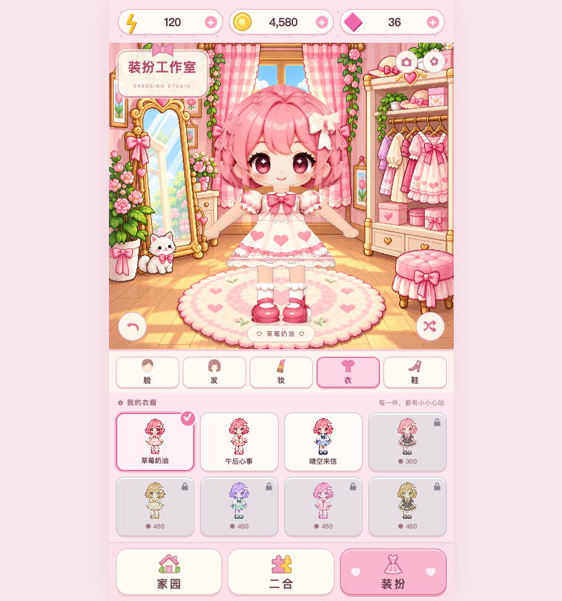

# Pixel Dress-up · 像素装扮小屋

[在线体验](https://jdb156158.github.io/PixelDress-up/)

[](https://jdb156158.github.io/PixelDress-up/)

参考提供的五张界面图制作的网页版换装小游戏，保留像素小屋界面并使用可旋转的骨骼人物。手机竖屏适配，桌面居中展示，无后端，运行库和素材均随站点提供。

## 玩法

- **装扮**：脸、发、妆、衣、鞋五个分类，直接预览搭配；发型含 8 款短发颜色与 8 款长发造型。金币解锁新服装，支持撤销、随机搭配和透明 PNG 导出。
- **家园**：进入家具布置，拖动、翻转或收回家具，从仓库添加八类家具。保存后保留布置，取消则恢复进入前的状态。
- **二合**：7×9 棋盘，拖动两个同类同等级物品合成，也可以依次轻点两格。轻点材料箱消耗体力生成物品，轻点包裹消耗金币腾出空间。交付订单获得金币、钻石和体力。
- **进度**：搭配、已解锁服装、资源、家具和合成棋盘保存在当前浏览器的 localStorage。设置内可关闭音效或确认重置。

[查看八款长发对比](docs/long-hair-preview.png)

## 本地运行

```sh
python3 -m http.server 4186 --directory dist
```

打开 [本地预览](http://localhost:4186)。直接双击 HTML 不适合图片导出，请通过 HTTP 运行。

### 骨骼人物

正式入口使用原游戏的房间、衣橱、分类、资源、家具与二合逻辑，只替换场景中的人物 Canvas。拖动人物转身，轻点挥手，双击回正；聚焦人物后按空格切换走路，方向键旋转。脸、发、妆、衣、鞋分类、解锁、撤销、随机、保存和 PNG 导出继续使用原有进度。

角色源文件为 `art/character/strawberry.blend`，建模脚本为 `scripts/build-character.py`，网页渲染器为 `dist/doll3d.js`。`dist/character.html` 保留独立人物预览，[原二维版本](https://jdb156158.github.io/PixelDress-up/classic.html) 用于回归对照。

## 验证

```sh
npm install
npx playwright install chromium
npm run check
# 另一个终端保持本地服务器运行
npm test
npm run test:classic
npm run test:hair
npm run test:long-hair
npm run test:merge-drag
```

可设置 `TEST_URL` 测试其他地址，设置 `PLAYWRIGHT_CHROMIUM_EXECUTABLE_PATH` 使用已安装的 Chromium 浏览器。

[浏览器验证记录](docs/verification.md) · [素材与生成提示词](docs/assets.md)

## 实现

`dist/index.html`、`dist/style.css` 和 `dist/app.js` 构成完整静态应用。人物通过 Three.js / three-vrm 渲染统一骨架与可换部件，家具使用透明像素图集，原生 Pointer Events 同时支持鼠标与触屏。素材保存在 `dist/assets/`，没有依赖外部图片服务。运行库及其许可证保存在 `dist/vendor/`。

GitHub Actions 在 `main` 更新时自动部署 `dist/` 至 GitHub Pages。
