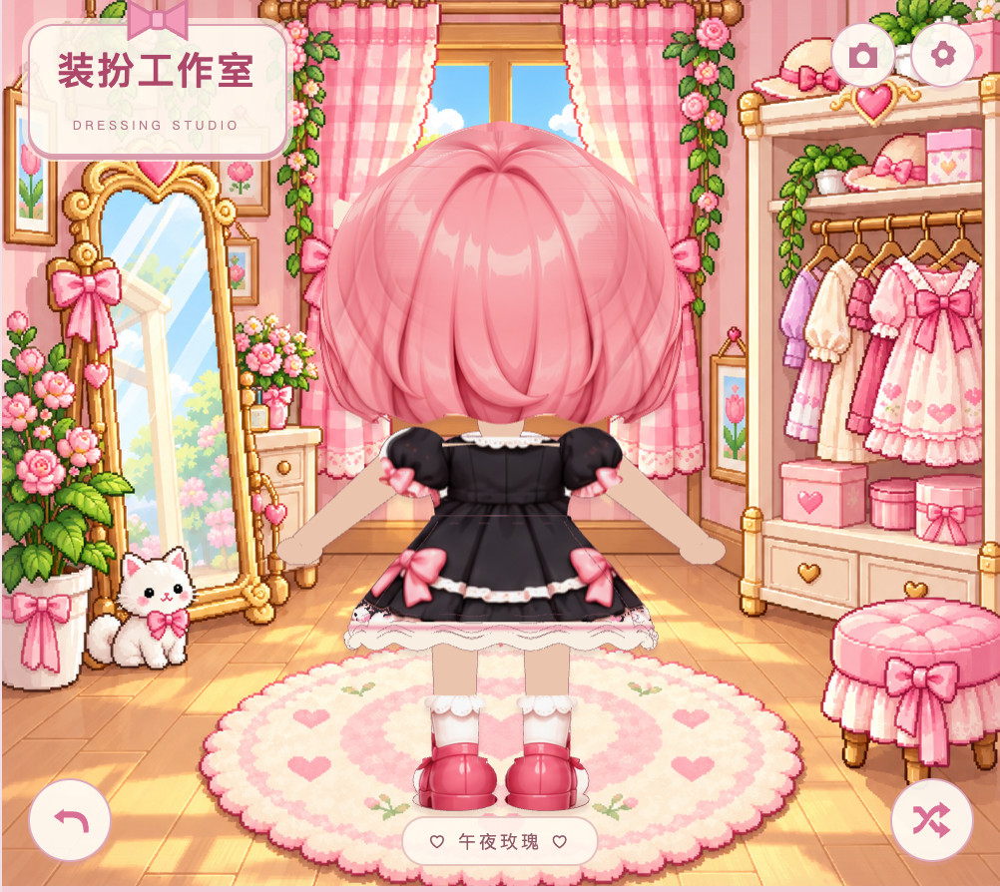
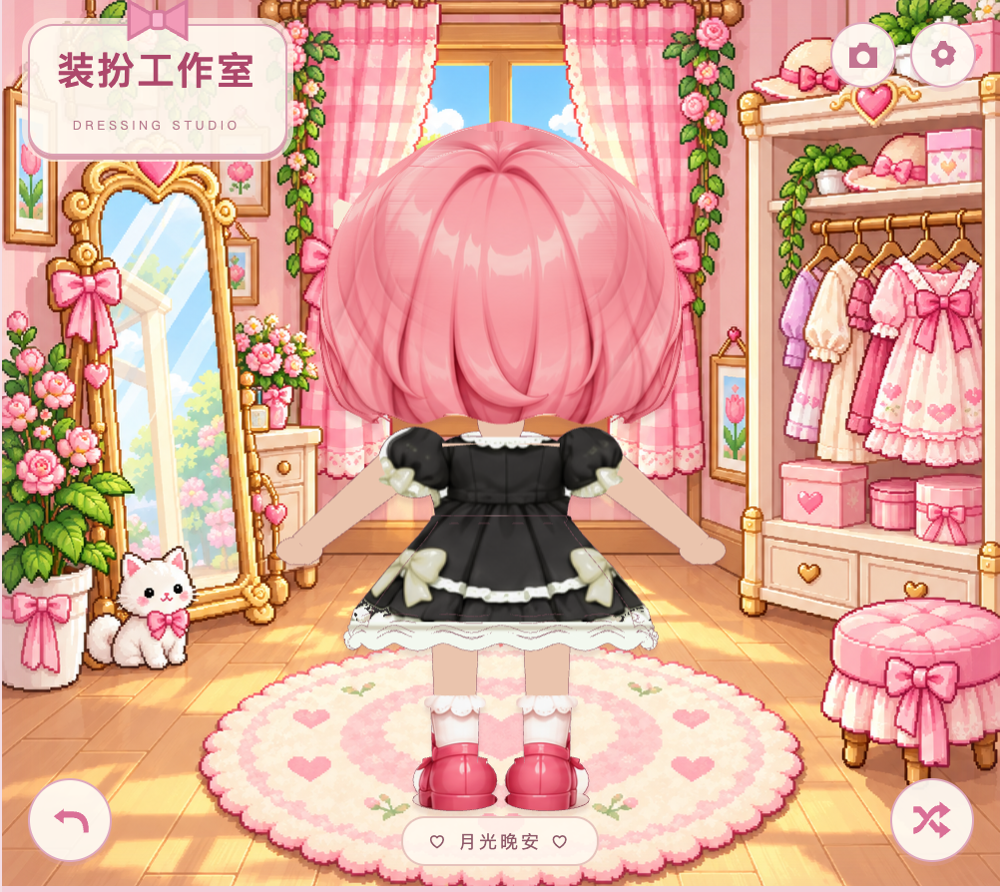

# 本地服装逐套检查

预览：http://localhost:4186/

每套检查正面、左右侧面、背面、挥手和走路，共 48 张渲染图。另对每套的挥手和走路各取 13 个时间点检查骨架数值，校验换装后仅一套服装和一对手部生效；替换身体参考图后，手部像素保持不变。

| 服装 | 六视图 |
| --- | --- |
| 草莓奶油 | [检查图](outfit-audit/1.png) |
| 午后心事 | [检查图](outfit-audit/2.png) |
| 晴空来信 | [检查图](outfit-audit/3.png) |
| 午夜玫瑰 | [检查图](outfit-audit/4.png) |
| 葡萄软糖 | [检查图](outfit-audit/5.png) |
| 薄荷来信 | [检查图](outfit-audit/6.png) |
| 桃子汽水 | [检查图](outfit-audit/7.png) |
| 月光晚安 | [检查图](outfit-audit/8.png) |

本次修正：长袖肩部接头收圆、袖口沿手臂方向连接；长袖和最低层裙边改为直接着色，避免参考图的背景、皮肤和图案被拉到边缘。

后背肩膀上方的白色尖角，经分别隐藏身体、服装和头发检查，主要是头发与肩膀之间的透明空隙露出了检查图底色。六视图改用蓝灰底以便区分；另保存两套深色衣服在实际房间中的背面，空隙会显示房间背景。

这些截图和骨架检查覆盖约定朝向及动作采样，不代表任意角度、任意新增动作都不会穿插。用户已确认当前材质与圆润头型并授权发布。
